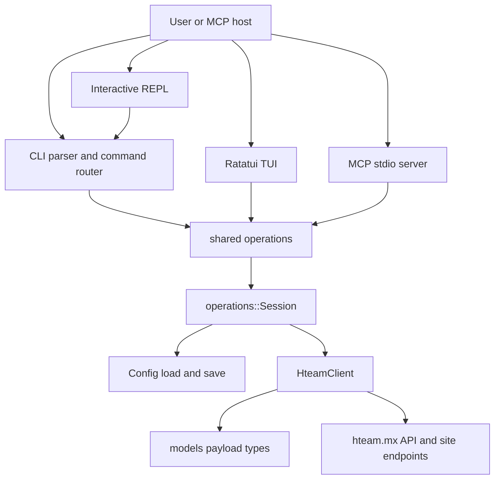

# System overview

`hteam` is a single Rust binary with several runtime domains, not a collection of separate apps. `src/main.rs` only starts Tokio and hands control to `cli::run()`. From there, the CLI router dispatches ordinary commands plus the long-lived `Interactive`, `Tui`, and `Mcp` modes. Those entrypoints are presentation adapters around one shared core.

## Owned runtime domains

The repository owns four main runtime domains:

- **CLI**: parses commands, decides whether output is human-readable or JSON, and dispatches subcommands.
- **TUI**: renders the kanban experience with `ratatui`, manages terminal lifecycle, and reacts to user input.
- **MCP**: exposes the same domain actions over stdio using `rmcp`.
- **Operations and transport**: hold shared use cases, board-resolution rules, session lifecycle, and the HTTP client that talks to Hteam.

The same authenticated session is the shared starting point for every surface. `operations::Session::open()` loads `Config` and opens `HteamClient::with_auth(config.clone())`, so CLI commands, the TUI, and MCP all begin from the same persisted credentials and local preferences.

## Layering rule

The repository follows a thin-adapter rule:

- **CLI, TUI, and MCP stay presentation-focused.** They parse input, shape output, handle UI state, and translate protocol-specific errors.
- **Business logic lives in `src/operations`.** That layer owns reusable workflows, ordering rules, fallback precedence, and cross-surface invariants.
- **`src/client` owns HTTP details.** It knows how to build requests, attach auth state, scrape or normalize remote quirks, and cache remote state when needed.
- **`src/models` owns payload mapping and normalization.** It keeps callers away from ad hoc `serde_json::Value` parsing.

This boundary matters because the same behavior must remain consistent across human terminal output, interactive TUI flows, and machine-oriented MCP calls.

## Shared session and board resolution

`operations::resolve_board_number()` is the single fallback chain for board selection: explicit override, then `Config.auth.board_number`, then `~/.last_ticket`. The TUI uses that resolver before it starts. Login persistence also stays at the operation boundary: after successful auth probing, `persist_login()` writes cookies, optional default-board data, `~/.last_ticket`, and `config.toml` together so board selection and persistence stay consistent.

Do not split board fallback logic across adapters. If a new surface needs a board, it should call the shared resolver rather than inventing its own precedence order.

## Transport and payload boundary

`HteamClient` is the only layer that should know the remote API shape in detail. It owns request construction, CSRF and cookie handling, endpoint selection, and client-side caches such as discovered IDs. It also absorbs protocol quirks that callers should not reimplement, including board selection defaults, board-id invalidation, comment form scraping, and tolerant handling of irregular JSON shapes.

`models` is the other hard boundary. It translates Hteam payloads into stable Rust types and normalizes inconsistent responses so callers do not parse `serde_json::Value` or compensate independently. If Hteam changes its payload shape, the adaptation belongs in `models` or immediately adjacent transport parsing, not in the CLI, TUI, or MCP layers.

## Failure and output behavior

Two behaviors matter when changing the architecture:

1. The CLI avoids writing the update notice on commands where extra stderr output would be misleading or would interfere with long-lived or machine-oriented modes.
2. Adapters must not let rendering failures, partial refresh failures, or protocol changes redefine core semantics. When a mutation fails in the TUI, the UI may revert its local view, but the remote change still goes through `operations` and `HteamClient`.

MCP turns successful domain values into JSON text content and converts `anyhow` failures into internal MCP errors. The CLI also supports `--json`, so stdout must stay clean of incidental notices. This is why transport and presentation concerns stay separated: the same use case needs to remain safe for human terminal output and machine consumption.

## Extension rules

When adding behavior:

1. Put reusable request sequences, defaults, and validations in `operations`.
2. Put every new remote API concern in `HteamClient`.
3. Extend `models` for external payload mapping or normalization.
4. Keep durable state changes explicit through `Config`.
5. Add only thin adapter glue in CLI, TUI, or MCP.

For board and card terminology, see [cards and board state](../concepts/cards-and-board-state.md). For session persistence and credential handling, see [session configuration](../concepts/session-configuration.md). For API transport details, see [Hteam API](../integrations/hteam-api.md). For MCP tool behavior, see [MCP server](../integrations/mcp-server.md).
