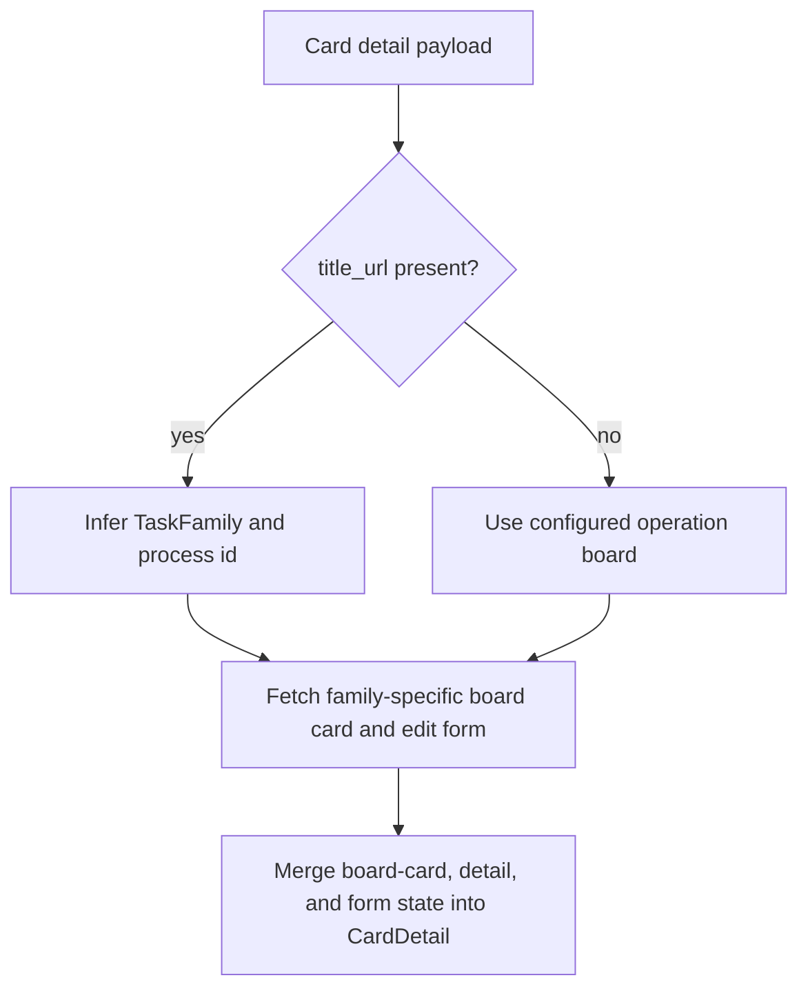
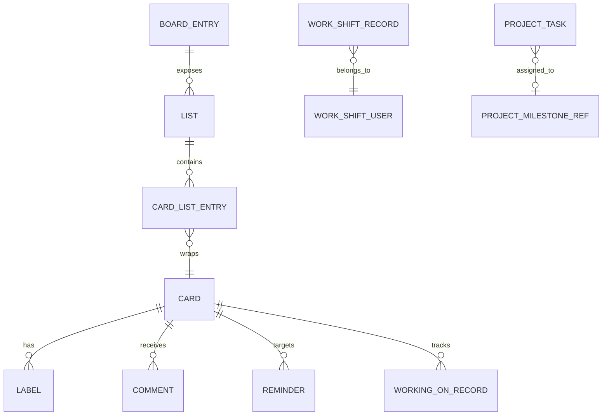

The cards layer is presentation-free domain logic. `operations` exposes list/card reads, search, enrichment, and mutations to the CLI, TUI, and MCP surfaces, while `HteamClient` owns the authenticated HTTP workflow. The remote API remains the system of record; local configuration only stores the active operation board number, cached internal `board_id`, known boards, and user ID.

## Identifier guide

Several numeric fields look similar but serve different roles.

| Identifier | Meaning and where it is used |
| --- | --- |
| **Board number** | The operation or project number configured in `auth.board_number`. List routes use it, task detail and comment pages use it as the operation id, and `move_card` sends it in a field named `board_id`. When omitted, the client resolves it from config and then `~/.last_ticket`. |
| **API `board_id`** | The internal board identifier carried by a `CardListEntry`. It is required by board-card creation and label/time/date update routes. The client caches it only after deriving it from a card-list response for the active board. |
| **List ID** | `List.id`, used in board-scoped list/cards routes and as the source or destination list in a move. The client treats list `1` as Open and list `2` as Closed for convenience helpers, but that is a client convention rather than a remote enum. |
| **Card ID** | `Card.id` / `CardDetail.id`, the task identity used for detail, comments, updates, reminders, and work tracking. It is not the same as the list-entry ID. |
| **Card-list entry ID** | `CardListEntry.id`, the identifier of the wrapper row in a list response. It is separate from the wrapped card ID and is not used as task identity. |
| **Working-on-it record ID** | `WorkingOnStatus.id`, the identity of a tracking record. It differs from `WorkingOnStatus.card_id`, which comes from the remote `object_id`. Stopping work uses the record ID, not the card ID. |
| **Project / milestone / shift / user / label / reminder / comment IDs** | Independent IDs returned by their respective endpoint payloads. A shift resume response embeds a user ID; project tasks may carry a milestone reference. |

## Task families and routing

Hteam keeps operation tasks and project tasks on separate API trees. The same task id can only be interpreted correctly when paired with the right family, so card mutations must respect the family encoded in the task URL.

`TaskFamily` is inferred from `title_url` when the task payload includes it. That matters for project cards in particular: the configured board number may point at an operation board, while a project task detail still needs the project family and project id from `/projects/{id}/tasks/{task_id}/`.

Caption: how task family selection drives board-card and edit-form lookup.

## Board selection and internal board ID discovery

The active board number is a local preference. Switching boards persists the number to `config.toml` and `~/.last_ticket`, updates the board display metadata, and records a last-used timestamp. When the board number changes, the cached internal `board_id` is cleared because it belongs to the previous board.

When the internal `board_id` is needed and no cache exists, the client first inspects list `1` (Open) and takes the first card-list entry's `board_id`. If Open is empty, it falls back to any nonempty list on the same board. If no card-list entry can be found, the operation fails with `No se pudo obtener board_id`.

Caption: the response-model relationships that matter for cards, lists, and related task state.

The diagram covers only response-model and endpoint-supported relationships. In particular, `CardListEntry` supplies the API `board_id` while `Card` supplies the card ID, and the tracking and reminder routes use the card `object_id`.

## Board and card shapes

`List` contains an ID, name, and optional `card_count` deserialized from `total_board_cards`. `CardListResponse` wraps each card in a `CardListEntry` that carries list-entry identity, `board_id`, closure, type, time, and position metadata, and the nested card. `get_cards_for` returns the nested cards plus only the first entry's `board_id`, discarding the wrapper metadata after extraction.

The compact `Card` uses API fields `title`, `subtitle`, and `labels_list` as Rust `name`, optional `description`, and labels. `CardDetail` is the richer read/edit shape and retains status, current list, timestamps, estimate, start date, dependency, responsible, priority, close state, and `title_url`.

Label decoding is intentionally defensive: `CardDetail` accepts an array of label objects, keeps only entries that deserialize successfully, and turns scalar or incompatible payloads into an empty label list. That prevents malformed or partially typed label payloads from breaking detail reads.

`Card::has_follow_up` detects the special `
