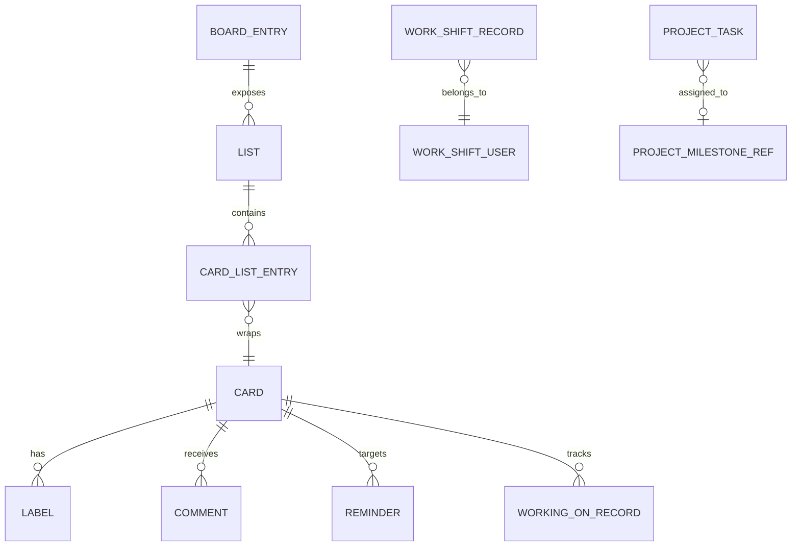

The card and board layer is deliberately presentation-free: `operations` exposes domain data and mutations to the CLI, TUI, and MCP surfaces, while `HteamClient` owns the authenticated HTTP workflow. The remote API is the system of record; local configuration stores the active operation board number, cached internal `board_id`, known boards, and user ID, but not board contents.

## Identifier guide

Several numeric fields look similar but serve different roles.

| Identifier | Meaning and where it is used |
| --- | --- |
| **Board number** | The operation/process number configured in `auth.board_number`. List routes use it, task detail and comment pages use it as the operation id, and `move_card` sends it in a field named `board_id`. When omitted, the client resolves it from config and then `~/.last_ticket`. |
| **API `board_id`** | The internal board identifier carried by a `CardListEntry`. It is required by board-card creation and label-update routes. The client caches it only after deriving it from a card-list response for the active board. |
| **List ID** | `List.id`, used in board-scoped list/cards routes and as the source/destination list in a move. The client treats list `1` as Open and list `2` as Closed for convenience helpers, but that is a client convention rather than a remote enum. |
| **Card ID** | `Card.id` / `CardDetail.id`, the task identity used for detail, comments, updates, reminders, and work tracking. It is not the same as the list-entry ID. |
| **Card-list entry ID** | `CardListEntry.id`, the identifier of the wrapper row in a list response. It is separate from the wrapped card ID and is not used as task identity. |
| **Working-on-it record ID** | `WorkingOnStatus.id`, the identity of a tracking record. It differs from `WorkingOnStatus.card_id`, which comes from the remote `object_id`. Stopping work uses the record ID, not the card ID. |
| **Project / milestone / shift / user / label / reminder / comment IDs** | Independent IDs returned by their respective endpoint payloads. A shift resume response embeds a user ID; project tasks may carry a milestone reference. |

## Board selection and internal board ID discovery

The active board number is a local preference. Switching boards persists the number to `config.toml` and `~/.last_ticket`, updates the board display metadata, and records a last-used timestamp. When the board number changes, the cached internal `board_id` is cleared because it belongs to the previous board.

When the internal `board_id` is needed and no cache exists, the client first inspects list `1` (Open) and takes the first card-list entry's `board_id`. If Open is empty, it falls back to any nonempty list on the same board. If no card-list entry can be found, the operation fails with `No se pudo obtener board_id`.

The diagram covers only response-model and endpoint-supported relationships. In particular, `CardListEntry` supplies the API `board_id` while `Card` supplies the card ID, and the tracking/reminder routes use the card `object_id`.

## Board and card shapes

`List` contains an ID, name, and optional `card_count` deserialized from `total_board_cards`. `CardListResponse` wraps each card in a `CardListEntry` that carries list-entry identity, `board_id`, closure/type/time/position metadata, and the nested card. `list_cards` returns the nested cards plus only the first entry's `board_id`, discarding the wrapper metadata after extraction.

The compact `Card` uses API fields `title`, `subtitle`, and `labels_list` as Rust `name`, optional `description`, and labels. `CardDetail` is the richer read/edit shape and retains status, current list, timestamps, estimate, start date, dependency, responsible, priority, and close state.

Label decoding is intentionally defensive: `CardDetail` accepts an array of label objects, keeps only entries that deserialize successfully, and turns scalar or incompatible payloads into an empty label list. That prevents malformed or partially-typed label payloads from breaking detail reads.

## Detail enrichment from multiple endpoints

A single task detail endpoint is not enough to reconstruct the full editing state. The client enriches `CardDetail` from three sources:

1. the task detail JSON,
2. the board-card JSON, and
3. the HTML edit form baseline.

`card_detail_enriched` first reads `CardDetail` from the task endpoint. If the internal `board_id` can be resolved, it fetches the board-card JSON and merges board-specific fields that the task detail often omits or exposes differently.

The merge rules are important:

- `estimated_time` from the board-card JSON becomes `time_estimated` when it is present and not blank or `---`.
- `time_spent` from the board-card JSON wins over `time_spend` when present; either form can populate `time_spend` in `CardDetail`.
- `start_date` and `due_date` are copied from the board-card JSON only when the task detail does not already provide them.
- `labels_list` from the board-card JSON replaces the detail labels only when it contains at least one valid label object.
- object-valued or string `responsible` values from the board-card JSON replace the task-detail responsible value, because the board-card view is the richer representation.
- `priority` is kept from the existing detail unless it is missing; then the board-card value is copied if present.

After board-card merging, the client consults the HTML task edit form baseline. That form is the source of truth for fields that the JSON detail views do not preserve reliably, especially `priority`, `time_estimated`, and the bare `dependence` task id. The edit-form merge only fills values that are still missing after the JSON merges, so it preserves already-known detail state instead of overwriting it.

## Safe card edits are read-modify-write

The task edit endpoint is form-shaped rather than a partial patch API. `update_card_fields` fetches current detail, then `update_card_full` GETs the HTML edit form and POSTs the complete form body back.

The form POST always includes the task id, name, description, estimate, start date, dependence, responsible, and priority. The patch behavior is merge-based:

- supplied name, description, priority, responsible, dependence, and time estimate override the scraped form values;
- absent fields are preserved from the form baseline or, when needed, from current detail;
- `start_date` is truncated to `YYYY-MM-DD` before posting;
- `dependence` must be a bare task id or `""` to clear it, never the display label form such as `#N - Title...`;
- absent priority defaults to `"3"` only when neither the detail nor the form supplies one.

Because the task edit endpoint needs a complete form, rebuilding the body from task JSON alone risks wiping sibling fields that only the HTML form knows about. The edit form is therefore part of the data model, not just a UI artifact.

## Creating and moving cards

Card creation resolves three prerequisites: internal `board_id`, active board number, and user ID. It posts a JSON body where `process` is the board number, `complement` is the user ID, and `labels` is either empty or contains the supplied `list_id`. Despite the name, that `labels` field is the implemented placement input for creation.

Successful creation may still return an empty body or an unusable card payload. In that case, the client searches the requested list by exact card name; if the card still cannot be found, it returns a placeholder `Card` with `id: 0`. Callers must not treat that fallback as confirmed remote identity.

Moving a card posts the card id, source and destination list ids, `card_type: 0`, and the selected board number under `board_id`. The convenience wrapper defaults an omitted source list to `1` (Open), so callers should pass `from_list` whenever the card might be elsewhere. HTTP failures are surfaced with status and response text.

## Closed and open list conventions

The client exposes `open_cards` and `closed_cards` helpers that simply call `get_cards(1, ...)` and `get_cards(2, ...)`. That is a convenience convention layered on top of list ids, not a remote schema guarantee.

Callers that move or close cards should respect the following invariants:

- use the card id for card-specific endpoints, not the list-entry id;
- use the operation board number when a route expects `operation_id` or `process`;
- use the internal `board_id` for board-card AJAX routes such as creation, label updates, and card time/date edits;
- resolve the source list before moving a card, because the move path requires both source and destination list ids;
- treat list `1` as Open and list `2` as Closed only when using the client helpers, not as a universal remote rule.

## Focused regression coverage

The repository's tests emphasize the edge cases that most often corrupt board state:

- extracting the internal `board_id` from a card-list response;
- falling back from Open to the first nonempty list when Open is empty;
- defaulting card moves to list `1` when the source is omitted;
- fetching the detail page before posting a full edit form;
- merging board-card data, edit-form data, and task-detail data without dropping fields;
- preserving the tolerant label decoder behavior;
- rejecting malformed comment dates before network I/O;
- normalizing reminder, work-tracking, project, and check-in payload shapes.

These tests are the best guide for safe changes to board state handling because they encode the invariants that keep identifiers, list membership, and detail enrichment consistent across surfaces.
