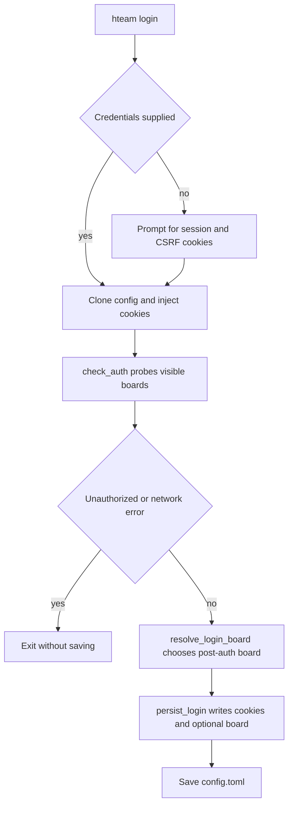

# Session and Configuration

Hteam keeps runtime-affecting user state in the durable `Config` model and in a small number of companion files in the user's home directory. The same stored session is shared by the CLI, TUI, and MCP entrypoints through `Session::open`, so changes to login, board resolution, or preference persistence affect every runtime surface.

## Durable state and file locations

`Config::config_dir()` resolves the platform configuration directory and appends `hteam`; `config.toml` is stored there. Loading tolerates a missing file by returning the default configuration, while save creates the directory if needed and rewrites the whole pretty-serialized file.

The configuration model persists:

- `[auth]` cookie and session state: `session_id`, `csrf_token`, optional `access_token` and `refresh_token`, plus the configured `board_number`, cached `board_id`, and cached `user_id`.
- `[boards.<id>]` metadata: display `name` and optional `last_used` timestamp.
- `[variables]` arbitrary string variables.
- `[tui] hidden_lists` and `[tui] known_projects`.
- `[working_hours] start` and `end`.
- `[weekly_objectives]` cache metadata and results.
- `[theme] active`.
- `[update]` cache metadata for update checks.

This file is credential-bearing. It is not encrypted, and the code does not enforce restrictive permissions, so the workstation or deployment environment is the protection boundary.

Additional local files include `~/.last_ticket`, which stores only a board number, and `~/.hteam_history`, which stores REPL history. The TUI also appends status output to `tui.log` in the configuration directory.

## Session construction

`Session::open` loads `Config` and creates an authenticated `HteamClient` from that configuration. That is the shared startup path used by the CLI, TUI, and MCP server, so they all honor the same authentication precondition instead of reconstructing the pair independently.

`Config::is_authenticated` only checks that `session_id` and `csrf_token` are present. `HteamClient::with_auth` uses that gate when constructing the client.

For requests, the client sends the configured cookies and CSRF header when present, and adds `Authorization: Bearer ...` only if an access token exists. The bearer token supplements the cookie session; it does not replace it.

## Login flow

The login command accepts `--session-id`, `--csrf-token`, and optional `--board`, prompting for missing credentials. It clones the current config, injects the supplied cookies into the clone, and then probes authentication before writing anything durable.

The login probe is board-aware but not board-hardcoded:

1. `check_auth` asks the API for visible boards.
2. `resolve_login_board` chooses the post-auth board using explicit `--board` first, then a still-visible configured default, then an automatic single-board selection when only one board is available.
3. `persist_login` writes the cookies and any selected board only after the probe succeeds.

If the probe reports unauthorized or fails over the network, the command exits without saving the new credentials. When a board is selected, login also updates the configured default, writes `~/.last_ticket`, and upserts the board metadata entry with the current timestamp.

This flow keeps durable state untouched until authentication has been verified.

## Board resolution and switching

Board selection uses one precedence chain everywhere a runtime needs a board number: explicit override, then the configured default, then the last-used fallback from `~/.last_ticket`. If all three are missing, the caller must report that a board is required.

`operations::boards::switch_board` is the durable switching path. It updates the configured board number, saves `~/.last_ticket`, resolves a display name from an explicit name, an existing board entry, or a fallback `Board <id>` label, stamps `last_used`, and saves the configuration. The board-switch flow in the TUI and the board command both rely on that operation.

The TUI resolves its initial board through the same precedence chain. After startup it keeps the selected board in memory, but board switches also invalidate the client's cached `board_id` so later board-specific API calls do not reuse a value from the prior board.

## TUI preferences and runtime behavior

The TUI loads `hidden_lists`, `known_projects`, `working_hours`, and `theme.active` from the session configuration when it starts. Hidden list names are normalized to lowercase, and the app still fetches the underlying lists and cards so a hidden list can be shown again without another fetch.

TUI preference writes reload durable configuration before saving, so they do not depend on a stale startup clone. Hiding or showing lists updates `[tui].hidden_lists`; loading a project moves its ID to the front of the deduplicated `[tui].known_projects` list. Save failures are surfaced in the live status bar, but the immediate UI action is not reverted.

Working hours only affect display logic. The TUI renders the remaining-work-time footer when `[working_hours]` parses to a valid local time range and the current time falls within that range. Invalid or missing values simply suppress the display.

Theme selection is also runtime-affecting: the TUI resolves `theme.active` at startup and uses the resolved theme for rendering.

## Client-side cache and persistence invariants

The client stores a cloned `Config` behind a mutex. Some changes are intentionally in-memory only, such as `set_board_number`, which updates the active board and clears the cached `board_id` without writing disk. That invalidation matters because a board-specific ID learned on one board must not be reused after switching to another board.

Other caches are resolved lazily from the server and may be persisted later depending on the code path. In particular, the session model and TUI logic should keep the distinction between durable configuration, request-time cached values, and short-lived UI state clear when they are changed.

## Extension and change guidance

- Keep `check_auth`, `resolve_login_board`, and `persist_login` aligned; login should continue to probe boards before persisting credentials.
- Preserve the board precedence chain: explicit override, configured default, then `~/.last_ticket`.
- Treat `config.toml` as sensitive user data when changing storage, logging, or export behavior.
- Reload durable configuration before persisting preference edits so one UI action does not overwrite unrelated current file state.
- Keep board switching invalidating cached board identity, and keep the TUI's startup board and preference loading in sync with the session configuration.

For broader delivery boundaries, see [System overview](../architecture/system-overview.md), [Terminal experiences](../operations/terminal-experiences.md), [Quickstart](../quickstart.md), and [Verification strategy](../testing/verification-strategy.md).
