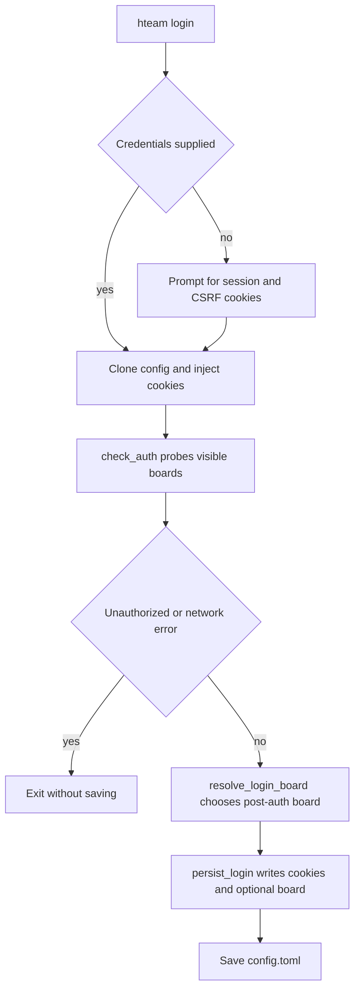

# Session and Configuration Model

Hteam keeps almost all user-local state in `config.toml` plus a few companion files under the home directory. The same configuration-loading path feeds the CLI, TUI, and MCP entrypoints, so authentication, board selection, and preference state must resolve the same way everywhere.

## Persisted state shape

`Config::config_dir()` resolves the platform config directory and appends `hteam`; `config.toml` lives there. `Config::load()` is forgiving: a missing file yields the default configuration, while `Config::save()` rewrites the whole pretty-serialized file and creates the directory tree when needed.

The persisted configuration groups that matter for runtime behavior are:

- `[auth]`: `session_id`, `csrf_token`, optional `access_token` and `refresh_token`, configured `board_number`, cached `board_id`, and cached `user_id`.
- `[boards.<id>]`: a display `name` plus optional `last_used` timestamp.
- `[variables]`: arbitrary string variables.
- `[tui]`: `hidden_lists` and `known_projects`.
- `[working_hours]`: `start` and `end`.
- `[weekly_objectives]`: source URL, freshness timestamp, cached title, and cached objectives.
- `[theme]`: active theme name.
- `[update]`: last-check timestamp, latest known release, and last seen version.

The file is credential-bearing. It is not encrypted, and the code does not enforce restrictive permissions, so the workstation or deployment environment is the protection boundary.

Companion local files are `~/.last_ticket` for the most recently used board number and `~/.hteam_history` for REPL history. The TUI also appends status output to `tui.log` in the configuration directory.

## Session construction and authentication

`Session::open()` is the common startup path: it loads `Config` and creates an authenticated `HteamClient` from that configuration. CLI, TUI, and MCP commands therefore inherit the same authentication precondition instead of reconstructing session state independently.

`Config::is_authenticated()` only checks that `session_id` and `csrf_token` are present. `HteamClient::with_auth` uses that gate when constructing the client.

For requests, the client sends the configured cookies and CSRF header when present, and adds `Authorization: Bearer ...` only if an access token exists. The bearer token supplements the cookie session; it does not replace it.

## Login flow and safe persistence

The login command accepts `--session-id`, `--csrf-token`, and optional `--board`, prompting for missing credentials. It clones the current config, injects the supplied cookies into the clone, and probes authentication before writing anything durable.

Board selection during login is intentionally post-auth and board-aware:

1. `check_auth` asks the API for visible boards.
2. `resolve_login_board` chooses a post-auth board using explicit `--board` first, then a still-visible configured default, then automatic selection when only one board is visible.
3. `persist_login` writes cookies and any selected board only after the probe succeeds.

If the probe reports unauthorized or fails over the network, the command exits without saving the new credentials. When a board is selected, login also updates the configured default, writes `~/.last_ticket`, and upserts the board metadata entry with the current timestamp.

This flow keeps durable state untouched until authentication has been verified.

## Board number resolution and board/project identity

The code distinguishes the active board number from project ids:

- `board_number` is the runtime board selector used by board-specific API calls and by the TUI board header.
- project ids live in the TUI's project picker state and in the remembered-project MRU list.

Board resolution uses a single precedence chain wherever a runtime needs a board number: explicit override, then the configured default, then the last board saved in `~/.last_ticket`. If all three are missing, the caller must report that a board is required.

`operations::boards::switch_board()` is the durable switching path. It updates the configured board number, saves `~/.last_ticket`, resolves a display name from an explicit name, an existing board entry, or a fallback `Board <id>` label, stamps `last_used`, and saves the configuration. Login uses the same persistence pattern after successful authentication, but only when a board can be selected from the visible board list.

Board switching also clears the client's cached `board_id` in memory so later board-specific API calls do not reuse a value from the previous board.

## TUI preferences and runtime state

The TUI reads `hidden_lists`, `known_projects`, `working_hours`, and `theme.active` from the session configuration at startup.

Hidden list names are normalized to lowercase. The app still fetches the underlying lists and cards even when a list is hidden, so a hidden list can be shown again without another network fetch. Toggling visibility reloads durable configuration before saving, which avoids overwriting unrelated current file state from a stale startup copy.

`known_projects` is a most-recently-used list of project ids, with optional cached names. Opening the projects popup auto-loads the first remembered project when no project is active yet, and selecting a project moves it to the front of the persisted MRU list. This is separate from the live projects list fetched from the API.

`working_hours` only affects display logic. The TUI renders the remaining-work-time footer when the configured range parses successfully and the current time falls within that range; invalid or missing values simply suppress the footer.

`theme.active` is resolved at startup and used for rendering. If the active name does not match a built-in theme or a parseable custom theme file, the theme resolver falls back to `default` and surfaces a warning.

## Cache freshness and lifecycle rules

Three persisted caches matter for runtime freshness:

- `[weekly_objectives]` uses `last_synced_at` and a 24-hour TTL.
- `[update]` uses `last_checked_at` and a 6-hour TTL.
- `[boards.<id>] last_used` and `~/.last_ticket` record recency for board selection, but they are not treated as freshness gates for API data.

The weekly-objectives cache is considered fresh only when `last_synced_at` parses as RFC3339 and is less than 24 hours old. A complete cached result can be reconstructed into a `WeeklyObjectivesSet` when a title has been saved. The update cache is separate: it tracks release-check freshness and the latest release/version metadata used by the startup update flow.

## Runtime entrypoints and defaults

The CLI command parser exposes `--board` globally for board-scoped commands, while `interactive`, `tui`, and `mcp` each derive their runtime behavior from the shared configuration layer.

`hteam interactive` loads config at startup and prints the active board when one is configured, but it does not mutate persisted session state by itself. `hteam tui` opens the board view with the same config-backed board selection and preference set. `hteam mcp` inherits the same session-loading rules as other authenticated entrypoints; it is not a separate configuration system.

When a runtime needs a board and no explicit board is provided, it uses the same precedence chain described above. That keeps the CLI, TUI, and MCP aligned on which board is current without duplicating board-selection logic in each surface.

## Safe-change invariants

- Keep `check_auth`, `resolve_login_board`, and `persist_login` aligned; login should continue to probe boards before persisting credentials.
- Never persist new cookies when auth probing fails or returns unauthorized.
- Preserve the board-number precedence chain: explicit override, configured default, then `~/.last_ticket`.
- Treat `config.toml` as sensitive user data when changing storage, logging, or export behavior.
- Reload durable configuration before persisting preference edits so one UI action does not overwrite unrelated current file state.
- Keep board switching invalidating cached board identity, and keep the TUI's startup board and preference loading in sync with the session configuration.
- Preserve the cache TTL split: weekly objectives stay at 24 hours, update checks stay at 6 hours.
