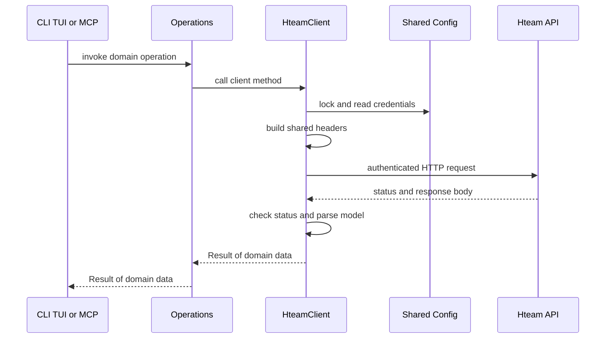
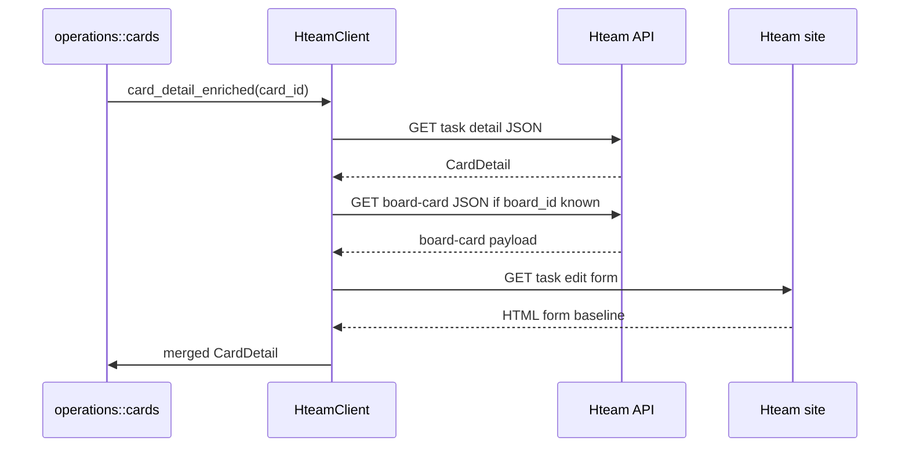
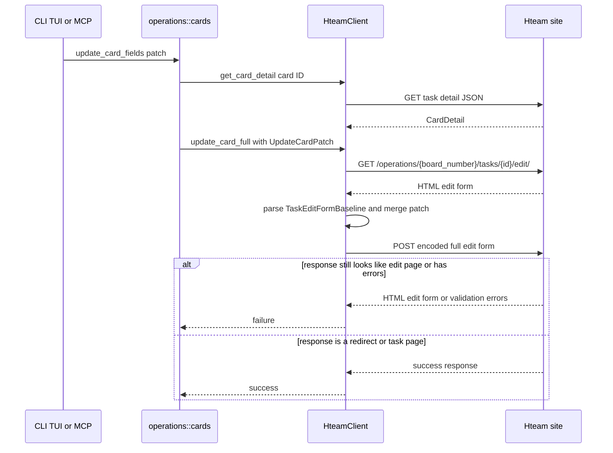

# Hteam API Integration

`HteamClient` is the HTTP boundary for Hteam. Presentation surfaces such as the CLI, TUI, and MCP call the shared `operations` layer, and that layer calls the client; they do not build request URLs, headers, or parsers themselves. The important consequence is that remote-service quirks stay isolated in one place: two base hosts, manual cookie and CSRF handling, JSON endpoints, browser-form endpoints, HTML scraping, and responses whose shape varies by family.

## Session probing and client construction

A normal client uses these fixed production bases:

- API endpoints: `https://hteam.mx/api`
- Site/browser endpoints: `https://hteam.mx`

`HteamClient::new` builds one `reqwest::Client` with a 30-second timeout and `curl/7.81.0` user agent, keeps the mutable `Config` behind `Arc<Mutex<_>>`, and initializes both base URLs. It does **not** use a cookie store; each request emits credentials explicitly. `HteamClient::with_auth` rejects configuration that does not already contain both `session_id` and `csrf_token`.

Login probing follows the same auth boundary as the application itself. The login flow creates a temporary client from candidate credentials, probes the boards list through `probe_auth`, and only persists the cookies after that probe succeeds. That means authentication is validated against a real Hteam response before the config is saved.

Every request starts from shared headers:

- `Referer: https://hteam.mx/`, `X-Requested-With: XMLHttpRequest`, and `Accept: */*`
- `Cookie: sessionid=…; csrftoken=…` and `X-CSRFToken: …` when both cookie values exist
- `Authorization: Bearer …` when an access token is configured

The client keeps configuration in memory, so callers can update the active board with `set_board_number`. That method also clears the cached internal `board_id`; a board ID discovered for one board must never be reused after switching. Durable selected-board persistence remains the responsibility of the session / board-switch operations, not the HTTP client.

## Major endpoint families

The client exposes family-specific methods instead of a generic request API. The families that matter for safe changes are:

| Family | Base and representative routes | Request and response style |
| --- | --- | --- |
| Boards / listing | API: `/operation/care/operations/` and `/operation/care/operations/{board}/lists/` | Reads use `?format=json`; the boards list is also the auth probe. The board-list response is the source of truth for whether the current session is authorized. |
| Cards | API: `/operation/care/operations/{board}/lists/{list}/cards/`, `/operation/care/tasks/{card}/`, and `/boards/care/boards/{board}/card/{card}/…` | JSON reads return cards and task details. Card creation, movement, labels, and board-card time/date updates are JSON mutations. |
| Comments | Site: `/comments/api/processes-task/{card}/` and `/comments/post/` | Comment reads return a `results` envelope. Posting is a browser-form flow that must scrape tokens from the task page before the POST. |
| Projects | API: `/project-new/care/projects/…` and `/project-new/care/{project}/tasks-projects/` | Project summary, milestone, and task endpoints return JSON. Project task lifecycle routes are separate from operation-task routes. |
| Working on it / reminders | API: `/tr/workingonit/`, `/tr/reminders/`, and `/tr/checkworkshifs/…` | These are JSON or URL-encoded AJAX-style calls depending on the action. Their readers accept a few server-shape variants, but only for the shapes seen in practice. |
| Daily work | Site: `/history/daily-work` | Query parameters are URL-encoded, and the response is parsed from HTML history paragraphs. |

`operations` primarily forwards these calls and returns plain data. Its meaningful policy additions are: card updates load the HTML edit form before POSTing a full body, movement defaults the source list to Open (ID 1), and comment date input is validated against `COMMENT_DATE_FORMAT` (`%Y-%m-%d %H:%M`) or defaults to local time.

## Board discovery and internal board_id resolution

Hteam distinguishes the user-facing board number from an internal `board_id`. The API methods that need the internal value do not assume a hardcoded board; they resolve it from live data.

`get_board_id` first tries the cached value in config. If it is missing, it fetches Open list 1 and extracts `board_id` from the first card-list entry. If Open is empty, it falls back to other lists that report a positive card count and retries them until one yields an ID. If no list produces an internal board ID, card creation fails instead of guessing.

That distinction matters because the board number and the internal `board_id` are used by different routes. The operation/process number appears in `/operations/{board_number}/…` and most task-edit URLs, while the internal board ID appears in board-card AJAX routes such as `/boards/care/boards/{board_id}/card/{card_id}/…`. When a caller changes boards, the cached internal ID is invalidated immediately.

## Card reads, creation, and movement

Card reads are intentionally split across more than one endpoint because no single response contains everything the UI needs.

- `get_card_detail` reads task detail JSON. If the detail payload says the task belongs to a project, the client retries the project task endpoint and returns that richer payload.
- `get_board_card` is the board-sidebar JSON, which carries fields such as `estimated_time`, `time_spent`, `labels_list`, and an object-shaped responsible field.
- `get_task_edit_form` scrapes the HTML edit form, which is the source of truth for `csrfmiddlewaretoken`, `name`, `description`, `time_estimated`, `start_date`, `dependence`, `responsible`, `priority`, and `milestone`.

This merging is deliberate: task detail JSON is not authoritative for several editable fields, and the board-card JSON is not authoritative for form-only values like the raw dependence id. The merge policy in `operations::cards::card_detail_enriched` reflects that hierarchy: board-card JSON fills in time, label, and responsible data, while the edit form fills in priority and estimate when the task detail payload is incomplete.

Card creation posts JSON with the card name, resolved user/complement, process or board number, and optional list labels. If the API returns an empty body or a response that decodes to card ID 0, the client treats that as an ambiguous success and tries to find the named card in the target list. If it still cannot identify the new card, it returns a placeholder card with ID 0 rather than inventing an identifier.

Card movement is a separate JSON call that posts `board_id`, `card_id`, `from_list`, `to_list`, and `card_type: 0`. The operation layer supplies the board number, but the client sends the internal board ID only where the route expects it.

## Project task families are separate from operation-task families

Project task actions live under a different API tree from operation task actions. `TaskFamily` makes that separation explicit, and the lifecycle methods choose the route family from the task's `title_url` when possible.

- Operation tasks use `/operation/care/tasks/{id}/close/` and `/operation/care/tasks/{id}/reopen/`
- Project tasks use `/project-new/care/tasks/{id}/close/` and `/project-new/care/tasks/{id}/reopen/`

`resolve_task_family` inspects the task detail `title_url` and defaults to `Operation` only when the URL is missing or unrecognized. This matters because the client intentionally treats the two trees as separate; safe changes must not assume that one close/reopen route works for both kinds of task.

## Browser-form card editing

The task edit flow is a browser form, not a partial JSON patch endpoint. `update_card_full` always GETs `/operations/{board_number}/tasks/{card_id}/edit/`, scrapes the current HTML form baseline, overlays only the explicit patch fields, and POSTs a complete URL-encoded form back to the same URL.

`TaskEditFormBaseline` is the source of truth for fields that the JSON detail endpoint cannot preserve reliably:

- `csrfmiddlewaretoken`
- `name`
- `description`
- `time_estimated`
- `start_date` in `YYYY-MM-DD` form
- `dependence` as a bare task id, or empty to clear
- `responsible` as a bare user id
- `priority` as `1`..=`5`
- `milestone` as a project milestone id, or empty when unassigned

The important safe-change rule is that the task detail JSON is not authoritative for these values. In particular, dependence is a display label in the detail payload but a bare id in the form, and priority is often missing from detail entirely. The form baseline is what prevents a patch to one field from accidentally clearing a sibling field that only the HTML form knows about.

`operations::cards::card_detail_enriched` mirrors the same trust hierarchy for reads: when detail JSON and board-card JSON disagree, the form and board-card sources supply the values that the UI cannot safely infer from task detail alone.

After the POST, the client treats the save as failed if the response still looks like the edit page, even when the HTTP status is 200. That catches silent validation failures and other cases where Django returns the form again instead of persisting the change.

## Browser-form comment posting

`post_comment` is also a multi-step browser interaction, not a direct API mutation. It first GETs the selected task page, then extracts the hidden `timestamp`, `security_hash`, and `csrfmiddlewaretoken` values, and only then POSTs a URL-encoded form to `/comments/post/`.

The comment form includes the card id, `processes.task` content type, comment body, local formatted date, and an optional `follow=on` flag. The site base is used for both the page scrape and the final POST, while `Origin` and `Referer` are set to match the browser form flow. If any required token is missing, the operation stops before the POST is attempted.

## Working state, reminders, and daily work

The working-state endpoints accept a small set of response shapes that have been observed in practice:

- Working status accepts an empty body or `null` as "no active records", then accepts either an array or a single object.
- Reminders accept empty or `null` as "no reminders", then accept either `{ "reminders": [...] }` or a bare array.
- User autocomplete accepts empty or `null`, then tries the documented `{ "results": [...] }` envelope followed by a bare array.
- Daily-work history is HTML, not JSON: the client reads `#history p`, extracts links and timestamps, and skips entries that do not contain usable text.

These are intentional compatibility shims, not a blanket permission to tolerate malformed data everywhere. Ordinary malformed JSON still propagates as an error after status validation.

## Objectives and update

Two auxiliary clients sit beside the main Hteam API boundary because the JSON surface is incomplete for their jobs.

`client::objectives` fetches a public SharePad notebook for weekly objectives. It first tries to extract markdown from Next.js RSC payloads under `self.__next_f.push([1,"..."])`, but it scopes extraction to the `"pages"` array because the same payload also contains unrelated SEO `content` fields. If the RSC payload format changes, it falls back to the rendered `.markdown-body` HTML and reconstructs the notebook from headings and task list items. This is a deliberate HTML and payload-shape fallback, not a generic scraper.

`client::update` talks to the GitHub Releases API for `Ditr4drian/hteam-cli`. It authenticates with `gh auth token` when available, uses `/releases/latest` to find the newest release, and downloads the `hteam-linux-x86_64` asset through the asset API URL with `Accept: application/octet-stream`. The code does not rely on `browser_download_url`, because the repository is private and that URL can 404 without browser-session cookies even when the asset API works.

## Errors, status handling, and safe extensions

Methods consistently return `anyhow::Result`. Transport failures gain operation-specific context such as "Error al obtener listas"; most non-success responses fail with the HTTP status and response body. Browser-form mutations and reminders use the equivalent `status >= 400` rule, which means redirect-class site responses can still count as success when the browser flow expects them. JSON decoding and HTML parsing errors propagate after status validation. The client does not implement retries, token refresh, or automatic recovery.

When extending the contract:

1. Add the remote call, request encoding, status policy, and model parsing to `HteamClient`, and choose the API or site base intentionally.
2. Reuse `build_headers`; keep special `Origin` and `Referer` requirements for browser-form routes.
3. Add a thin operation that returns domain data and leaves rendering to CLI, TUI, or MCP.
4. Preserve cache scope: clear board-specific values on board changes and persist only values whose scope warrants it.
5. Add or update `mockito` tests through `new_for_test`, which lets the API and site bases be swapped independently during tests.

Focused tests cover representative list and card JSON mapping, project-task refetching, move and update request bodies, comment scraping and autocomplete, working start/stop payloads, project decoding, daily-work HTML parsing, and configurable mock hosts.

## Related pages

- [Cards and board state](../concepts/cards-and-board-state.md)
- [Login and Board Selection Workflow](../workflows/login-and-board-selection.md)
- [Card mutations and comments](../workflows/card-mutations-and-comments.md)
