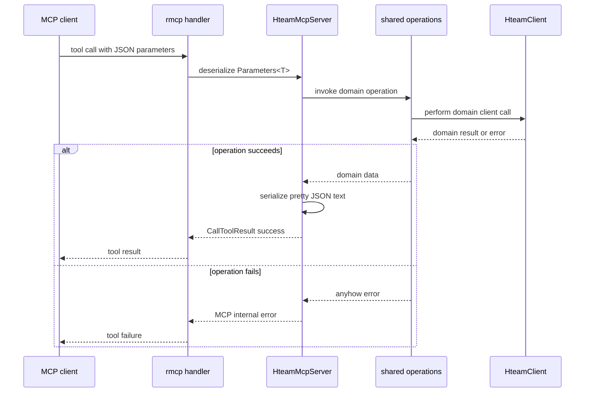

# MCP Server Integration

<!-- openwiki: broken internal link [../openwiki/architecture/system-overview.md] file "../openwiki/architecture/system-overview.md" does not exist. Fix the href or restore the target, then delete this comment. -->
`hteam mcp` is the Model Context Protocol (MCP) delivery surface for Hteam. The CLI dispatches `mcp::run`, which opens one authenticated [`Session`](../openwiki/architecture/system-overview.md) and serves an `HteamMcpServer` over rmcp's stdio transport. The MCP layer is intentionally thin: handlers map JSON-RPC tool inputs into shared `operations` functions, and those operations in turn use `HteamClient`. The server does not duplicate HTTP, patching, or presentation logic; it preserves the same domain workflow and defaults as the terminal-facing application.

## Startup and lifetime

Start the server with:

```bash
hteam mcp
```

Startup is all-or-nothing. `Session::open()` loads persisted configuration and constructs an authenticated `HteamClient`; if credentials are missing or invalid, server startup fails instead of exposing an unauthenticated MCP endpoint. The resulting client is wrapped in `Arc<HteamClient>` so all tool handlers in the same service share one authenticated session for the process lifetime.

`serve(stdio())` establishes the stdio service, and `waiting()` keeps the process alive until the service ends. Errors from either stage are written to standard error with MCP-server or MCP-service context and then propagated. This matters for stdio transport: JSON-RPC protocol traffic must stay on stdout/stdin, while diagnostics and startup failure messages belong on stderr so they do not corrupt the wire protocol.



## Schema-to-operation adapter

Each tool method is registered by `#[tool_router(server_handler)]`, and each structured argument is a `Parameters<T>` wrapper around a Rust type that derives both `Deserialize` and `JsonSchema`. That means the same parameter struct drives runtime deserialization and the JSON Schema published to MCP clients. Required Rust fields become required tool inputs; `Option<T>` fields become optional tool inputs.

Parameter names are the MCP JSON names, not CLI flag names or positional arguments. For example, handlers accept `card_id`, `list_id`, `to_list`, `from_list`, `working_id`, `project_id`, `activity_type`, and similar field names that match the tool contract.

The adapter rules are deliberate:

- Board-scoped reads and moves may accept optional `board`; when omitted, the shared client resolves the configured board or last ticket through the existing session logic.
- `card_create` requires `name` and accepts an optional `list_id`.
- `card_update` is the strict case: it requires both `card_id` and `board`, and its editable fields are optional. The underlying operation first reads the current card state so omitted fields preserve the current patch base.
- `card_comment` requires `card_id` and `comment`; `follow` defaults to `false`, and `date` is optional. Date parsing uses the shared comment-date format and local-time defaulting in operations.
- `working_stop` requires a working-record ID, not a card ID; the record ID comes from `working_list` / `working_on`.
- `daily_work` accepts optional `user`, `activity_type`, and `range` filters.
- `users_search` requires a query string, and project tools require `project_id`.

Do not add request-shaping, URL construction, or output formatting code to a tool handler. If a new MCP capability is needed, first add or reuse a shared operation that accepts `&HteamClient`, then add the schema parameter type and a thin handler that translates fields and selects the MCP result form.

## Tool groups

The server currently registers 22 tools. The groups below describe the public surface; the remote endpoints and mutation protocols remain in the shared operations and `HteamClient` contract.

| Domain | Tools | Purpose and key inputs |
| --- | --- | --- |
| Board and card reads | `lists`, `cards_list`, `cards_open`, `cards_closed`, `card_detail`, `card_labels`, `cards_search` | List board lists; list a specified list; read the conventionally Open or Closed cards; retrieve a card or its labels; and search cards by text, responsible, priority, labels, and optional board/list scope. |
| Card mutations | `card_create`, `card_move`, `card_update_desc`, `card_update`, `card_remind` | Create by name, move between lists, update only description, apply a full card patch, or create a reminder. `card_move` uses Open list 1 when `from_list` is omitted. |
| Comments and follow-ups | `card_comments`, `card_comment`, `card_follow_up`, `card_follow_up_complete`, `card_follow_up_cancel` | Retrieve comments, post a comment with optional board/follow/date fields, inspect a follow-up, or complete/cancel a follow-up by its follow-up id. |
| Working on it | `working_list`, `working_start`, `working_stop` | Read active work, start it for a card, or stop it by `working_id`. |
| Projects | `project_milestones`, `project_tasks` | Read a project's milestone progress or task/status/responsibility data by `project_id`. |
| People and activity | `users_search`, `reminders`, `check_in`, `daily_work` | Search users, list pending reminders, check in, and read daily-work history with optional filters. |

Tool names are stable integration names, independent of the CLI command hierarchy. Tools return domain models rather than terminal tables; for example, `cards_list` returns only the card vector even though the shared operation also resolves the selected board.

## Results and failure semantics

Every successful handler passes its value through `ok`. That helper serializes the value with `serde_json::to_string_pretty` and returns exactly one MCP `Content::text(...)` item in `CallToolResult::success`. Successful reads therefore return pretty-printed JSON as text, and mutations that do not return a natural domain object use explicit JSON acknowledgements such as `{"success": true, "card_id": ...}`, `{"success": true, "follow_up_id": ...}`, or `{"success": true, "working_id": ...}`.

Operation failures and serialization failures both become MCP internal errors. The handlers use `map_err(err)?`, and `err` converts `anyhow::Error` into `McpError::internal_error(...)`. As a result, remote HTTP failures, authentication or configuration problems discovered during a delegated operation, and validation failures such as an invalid comment date are surfaced to the MCP client as tool failures instead of success responses containing error text.

## Read-only versus mutating workflows

The tool surface is split between read-only queries and mutations:

- Read-only: `lists`, `cards_list`, `cards_open`, `cards_closed`, `card_detail`, `card_labels`, `cards_search`, `card_comments`, `card_follow_up`, `working_list`, `project_milestones`, `project_tasks`, `users_search`, `reminders`, `check_in`, and `daily_work`.
- Mutating: `card_create`, `card_move`, `card_update_desc`, `card_update`, `card_remind`, `card_comment`, `card_follow_up_complete`, `card_follow_up_cancel`, `working_start`, and `working_stop`.

This distinction matters operationally. Read-only tools can be retried without changing server state, while mutating tools should be treated as state-changing operations that may have already succeeded remotely if the transport is interrupted after the request leaves the client. The MCP layer does not invent compensation logic; it simply propagates the shared operation outcome.

## Safe extension and verification

When adding a tool, keep the boundary sequence: implement or reuse the domain operation, define a `Deserialize + JsonSchema` parameter struct, add the `#[tool]` handler in `HteamMcpServer`, delegate to the operation, and return `ok(value)` or a narrowly scoped success acknowledgement only after success. Preserve defaults already centralized by operations, such as movement defaulting `from_list` to 1, full updates fetching their patch base, comment timestamps using local format/defaulting, and stopping work requiring the working record rather than the card.

Representative tests at the operations boundary cover the behaviors this adapter depends on: card-list delegation, default Open-list movement, two-step full update, comment date parsing and validation, and working-record identity plus start/stop transport behavior. The MCP layer should remain thin enough that most logic changes belong in `operations` or `HteamClient`; add MCP-specific tests only when parameter mapping, result envelopes, or error translation introduce behavior that delegation tests do not cover.
